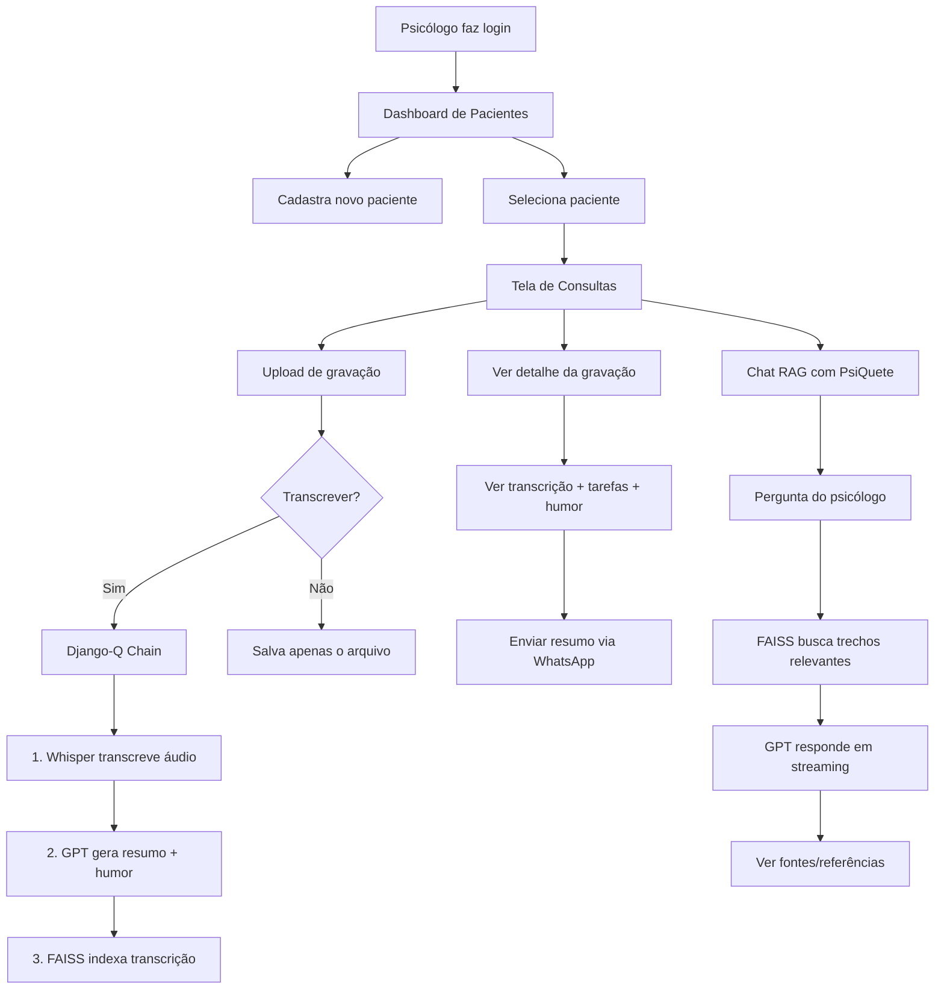

# 🧠 Análise Completa — Sistema PsiQuê (Arcane 2)

## Objetivo do Sistema

O **PsiQuê** é uma plataforma web para **psicólogos** que utiliza **Inteligência Artificial (OpenAI GPT-4.1-mini + Whisper)** para:

1. **Gerenciar pacientes** — cadastro com foto, descrição e telefone
2. **Gravar e transcrever sessões** — upload de áudio/vídeo de consultas psicológicas, transcrição automática via Whisper
3. **Resumir sessões com IA** — geração automática de tarefas, lembretes e resumos da sessão
4. **Avaliar humor do paciente** — nota de 1 a 5 gerada pela IA com base na transcrição
5. **Chat RAG (Retrieval-Augmented Generation)** — o psicólogo pode "conversar" com a IA fazendo perguntas sobre sessões passadas, com respostas baseadas nas transcrições reais (usando FAISS como vector store)
6. **Enviar resumos via WhatsApp** — integração com Evolution API para enviar resumos ao paciente
7. **Gráfico de evolução do humor** — visualização temporal do humor do paciente (Chart.js)

---

## Stack Tecnológica

| Componente | Tecnologia |
|---|---|
| Backend | **Django 5.2.7** (Python 3.12) |
| IA / LLM | **OpenAI GPT-4.1-mini** (via LangChain) |
| Transcrição | **OpenAI Whisper** |
| Vector Store (RAG) | **FAISS** (faiss-cpu) |
| Embeddings | **OpenAI Embeddings** |
| Tarefas assíncronas | **Django-Q2** (com ORM backend) |
| Frontend / CSS | **Tailwind CSS 4** (via CDN browser) |
| Gráficos | **Chart.js** |
| WhatsApp | **Evolution API** (wrapper customizado) |
| Arquivos estáticos | **WhiteNoise** |
| Servidor WSGI | **Gunicorn** |
| Containerização | **Docker** |
| Deploy | **Railway** (indicado pelo `CSRF_TRUSTED_ORIGINS`) |
| Banco de dados | **SQLite3** |

---

## Estrutura de Pastas e Arquivos

### 📁 Raiz do Projeto

| Arquivo | Descrição |
|---|---|
| [manage.py](file:///c:/Users/W10/OneDrive/Documentos/Pythonando/Arcane2/base_psique_arcane2-master/manage.py) | Entry point padrão do Django para comandos administrativos |
| [requirements.txt](file:///c:/Users/W10/OneDrive/Documentos/Pythonando/Arcane2/base_psique_arcane2-master/requirements.txt) | 70 dependências do projeto — inclui Django, LangChain, OpenAI, FAISS, Pillow, Redis, etc. |
| [Dockerfile](file:///c:/Users/W10/OneDrive/Documentos/Pythonando/Arcane2/base_psique_arcane2-master/Dockerfile) | Container Python 3.12, instala dependências, copia código e executa `entrypoint.prod.sh` |
| [entrypoint.prod.sh](file:///c:/Users/W10/OneDrive/Documentos/Pythonando/Arcane2/base_psique_arcane2-master/entrypoint.prod.sh) | Script de produção — roda `migrate`, `collectstatic`, `qcluster` (worker Django-Q) e `gunicorn` |
| [.gitignore](file:///c:/Users/W10/OneDrive/Documentos/Pythonando/Arcane2/base_psique_arcane2-master/.gitignore) | Ignora `__pycache__`, `.env`, `db.sqlite3`, `faiss/`, venvs, etc. |

---

### 📁 `core/` — Configuração do Projeto Django

| Arquivo | Descrição |
|---|---|
| [settings.py](file:///c:/Users/W10/OneDrive/Documentos/Pythonando/Arcane2/base_psique_arcane2-master/core/settings.py) | Configurações centrais: apps (`usuarios`, `consultas`, `django_q`), SQLite, WhiteNoise, variáveis via `python-decouple` (`DEBUG`, `OPENAI_API_KEY`), message tags para Tailwind, Django-Q cluster config |
| [urls.py](file:///c:/Users/W10/OneDrive/Documentos/Pythonando/Arcane2/base_psique_arcane2-master/core/urls.py) | Roteamento raiz — `/admin/`, `/usuarios/`, `/consultas/` + servir media |
| `asgi.py` / `wsgi.py` | Entry points ASGI/WSGI padrão |

---

### 📁 `usuarios/` — App de Autenticação e Pacientes

| Arquivo | Descrição |
|---|---|
| [models.py](file:///c:/Users/W10/OneDrive/Documentos/Pythonando/Arcane2/base_psique_arcane2-master/usuarios/models.py) | Model `Pacientes`: `nome`, `descricao`, `foto` (ImageField), `ativo` (bool), `telefone` |
| [views.py](file:///c:/Users/W10/OneDrive/Documentos/Pythonando/Arcane2/base_psique_arcane2-master/usuarios/views.py) | **3 views:** `cadastro` (criar conta), `login` (autenticação), `pacientes` (listar/criar pacientes) |
| [urls.py](file:///c:/Users/W10/OneDrive/Documentos/Pythonando/Arcane2/base_psique_arcane2-master/usuarios/urls.py) | Rotas: `/cadastro/`, `/login/`, `/pacientes/` |

#### Templates de `usuarios/`:

| Template | Descrição |
|---|---|
| [cadastro.html](file:///c:/Users/W10/OneDrive/Documentos/Pythonando/Arcane2/base_psique_arcane2-master/usuarios/templates/cadastro.html) | Página de registro — formulário com username, senha e confirmação, imagem de fundo |
| [login.html](file:///c:/Users/W10/OneDrive/Documentos/Pythonando/Arcane2/base_psique_arcane2-master/usuarios/templates/login.html) | Página de login — formulário + botões (decorativos) de Google/GitHub OAuth |
| [pacientes.html](file:///c:/Users/W10/OneDrive/Documentos/Pythonando/Arcane2/base_psique_arcane2-master/usuarios/templates/pacientes.html) | Dashboard de pacientes — lista em cards + modal para cadastrar novo paciente |

---

### 📁 `consultas/` — App Principal (Gravações, IA, Chat RAG)

| Arquivo | Descrição |
|---|---|
| [models.py](file:///c:/Users/W10/OneDrive/Documentos/Pythonando/Arcane2/base_psique_arcane2-master/consultas/models.py) | **3 Models:** `Gravacoes` (vídeo, data, transcrição, resumo JSON, segmentos JSON, humor, FK paciente), `DataTreinamento` (chunk de texto + FK gravação), `Pergunta` (texto da pergunta + M2M com DataTreinamento) |
| [views.py](file:///c:/Users/W10/OneDrive/Documentos/Pythonando/Arcane2/base_psique_arcane2-master/consultas/views.py) | **6 views:** `consultas` (listar/criar gravações), `gravacao` (detalhe da gravação), `chat` (interface de chat), `stream_response` (streaming RAG), `ver_referencias` (fontes usadas pela IA), `send_message` (enviar resumo via WhatsApp) |
| [urls.py](file:///c:/Users/W10/OneDrive/Documentos/Pythonando/Arcane2/base_psique_arcane2-master/consultas/urls.py) | 6 rotas correspondentes às views |
| [agents.py](file:///c:/Users/W10/OneDrive/Documentos/Pythonando/Arcane2/base_psique_arcane2-master/consultas/agents.py) | **Coração da IA** — 3 agentes: `SummaryAgent` (gera resumo da sessão com structured output), `EvaluationAgent` (avalia humor 1-5), `RAGContext` (treina FAISS com transcrições, busca por similaridade, streaming de resposta via GPT-4.1-mini) |
| [tasks.py](file:///c:/Users/W10/OneDrive/Documentos/Pythonando/Arcane2/base_psique_arcane2-master/consultas/tasks.py) | **3 tarefas assíncronas (Django-Q):** `transcribe_recording` (Whisper), `summary_recording` (IA summary + humor), `task_rag` (indexa no FAISS) |
| [signals.py](file:///c:/Users/W10/OneDrive/Documentos/Pythonando/Arcane2/base_psique_arcane2-master/consultas/signals.py) | Signal `post_save` em `Gravacoes` — quando uma gravação é criada com `transcrever=True`, dispara chain: transcrição → resumo → indexação RAG |
| [wrapper_evolutionapi.py](file:///c:/Users/W10/OneDrive/Documentos/Pythonando/Arcane2/base_psique_arcane2-master/consultas/wrapper_evolutionapi.py) | Wrapper para Evolution API (WhatsApp) — classe `SendMessage` para enviar mensagens de texto |
| [apps.py](file:///c:/Users/W10/OneDrive/Documentos/Pythonando/Arcane2/base_psique_arcane2-master/consultas/apps.py) | Config da app — importa signals no `ready()` |
| [admin.py](file:///c:/Users/W10/OneDrive/Documentos/Pythonando/Arcane2/base_psique_arcane2-master/consultas/admin.py) | Registra `Gravacoes` no admin do Django |

#### Templates de `consultas/`:

| Template | Descrição |
|---|---|
| [consultas.html](file:///c:/Users/W10/OneDrive/Documentos/Pythonando/Arcane2/base_psique_arcane2-master/consultas/templates/consultas.html) | Página do paciente — header com foto, tabela de gravações (status transcrição/resumo), formulário de upload, gráfico de humor (Chart.js) |
| [gravacao.html](file:///c:/Users/W10/OneDrive/Documentos/Pythonando/Arcane2/base_psique_arcane2-master/consultas/templates/gravacao.html) | Detalhe de uma gravação — stats (palavras, tarefas, humor), transcrição completa, lista de tarefas/lembretes, botão "Enviar resumo" (WhatsApp) |
| [chat.html](file:///c:/Users/W10/OneDrive/Documentos/Pythonando/Arcane2/base_psique_arcane2-master/consultas/templates/chat.html) | Interface de chat estilo WhatsApp com a assistente "PsiQuete" — streaming de respostas via Fetch API + ReadableStream |
| [ver_referencia.html](file:///c:/Users/W10/OneDrive/Documentos/Pythonando/Arcane2/base_psique_arcane2-master/consultas/templates/ver_referencia.html) | Mostra as fontes (trechos de gravações) usadas pela IA para responder uma pergunta, com timestamp do vídeo |

#### Templatetags:

| Arquivo | Descrição |
|---|---|
| [consultas_filters.py](file:///c:/Users/W10/OneDrive/Documentos/Pythonando/Arcane2/base_psique_arcane2-master/consultas/templatetags/consultas_filters.py) | Filtros customizados: `tempo_video` (localiza o timestamp de um trecho na transcrição) e `count_words` (conta palavras) |

---

### 📁 `prompts/` — Prompts da IA

| Arquivo | Descrição |
|---|---|
| [prompts.py](file:///c:/Users/W10/OneDrive/Documentos/Pythonando/Arcane2/base_psique_arcane2-master/prompts/prompts.py) | **3 prompts:** `SUMMARY_PROMPT` (resumir reunião em lista), `PSI_PROMPT` (especialização psicológica — tarefas, exercícios, próximos passos, sem dados sensíveis), `EVALUATION_PROMPT` (avaliar humor 1-5) |

---

### 📁 `templates/` — Templates Globais e Assets

| Arquivo | Descrição |
|---|---|
| [base.html](file:///c:/Users/W10/OneDrive/Documentos/Pythonando/Arcane2/base_psique_arcane2-master/templates/base.html) | Layout base — carrega Tailwind CSS 4 via CDN, define blocks `head` e `body` |
| `static/` | Imagens: `logo.png`, `bg.jpg` (fundo do login), `assistente_virtual.png` (avatar do chat) |

---

### 📁 `staticfiles/` — Arquivos Estáticos Compilados (WhiteNoise)

Contém os assets coletados pelo `collectstatic` + manifesto (`staticfiles.json`) e cópias com hash para cache-busting.

---

### 📁 `media/` — Uploads de Usuários

| Subpasta | Descrição |
|---|---|
| `fotos/` | Fotos dos pacientes (upload via ImageField) |
| `gravacoes/` | Arquivos de áudio/vídeo das sessões |

---

## Fluxo Principal do Sistema

---

## 🟡 O Sistema Está Pronto Para Uso?

### ✅ O que ESTÁ funcionando / implementado:

| Item | Status |
|---|---|
| Cadastro e login de usuários | ✅ Implementado |
| CRUD de pacientes (criar + listar) | ✅ Implementado |
| Upload de gravações | ✅ Implementado |
| Transcrição automática (Whisper) | ✅ Implementado |
| Resumo + avaliação de humor (IA) | ✅ Implementado |
| Chat RAG com streaming | ✅ Implementado |
| Referências/fontes das respostas | ✅ Implementado |
| Gráfico de evolução de humor | ✅ Implementado |
| Docker + deploy Railway | ✅ Configurado |
| Tarefas assíncronas (Django-Q) | ✅ Configurado |

### ⚠️ Problemas e pendências que impedem uso em produção:

| # | Problema | Severidade | Detalhe |
|---|---|---|---|
| 1 | **SECRET_KEY hardcoded** | 🔴 Crítico | A `SECRET_KEY` está fixa no código-fonte, deveria vir de variável de ambiente |
| 2 | **ALLOWED_HOSTS = `['*']`** | 🔴 Crítico | Aceita qualquer host, vulnerável a ataques de header |
| 3 | **SQLite em produção** | 🟡 Importante | SQLite não suporta bem concorrência; deveria usar PostgreSQL |
| 4 | **Evolution API não configurada** | 🟡 Importante | [wrapper_evolutionapi.py](file:///c:/Users/W10/OneDrive/Documentos/Pythonando/Arcane2/base_psique_arcane2-master/consultas/wrapper_evolutionapi.py) tem `'seu_dominio_aqui'` e `'sua_chave_aqui'` como placeholders |
| 5 | **Sem autenticação nas views** | 🟡 Importante | Nenhuma view usa `@login_required` — qualquer pessoa pode acessar pacientes e gravações sem login |
| 6 | **Dados hardcoded no template** | 🟠 Moderado | [pacientes.html](file:///c:/Users/W10/OneDrive/Documentos/Pythonando/Arcane2/base_psique_arcane2-master/usuarios/templates/pacientes.html) mostra "Caio Sampaio" e texto Lorem Ipsum hardcoded em vez dos dados reais (`paciente.nome`, `paciente.descricao`) |
| 7 | **Humor médio hardcoded** | 🟠 Moderado | [gravacao.html](file:///c:/Users/W10/OneDrive/Documentos/Pythonando/Arcane2/base_psique_arcane2-master/consultas/templates/gravacao.html#L58) mostra "3 de 5" fixo em vez do cálculo real |
| 8 | **Botões OAuth decorativos** | 🟠 Moderado | Botões Google/GitHub no login não têm funcionalidade |
| 9 | **Sem logout** | 🟠 Moderado | Não existe rota nem botão de logout |
| 10 | **Nome "Ana" hardcoded no chat** | 🟠 Moderado | [chat.html](file:///c:/Users/W10/OneDrive/Documentos/Pythonando/Arcane2/base_psique_arcane2-master/consultas/templates/chat.html#L11) mostra "Ana" fixo em vez de `{{ paciente.nome }}` |
| 11 | **`@csrf_exempt` nas views do chat** | 🟡 Segurança | As views `chat` e `stream_response` desabilitam CSRF |
| 12 | **Sem HTTPS forçado** | 🟠 Moderado | Falta `SECURE_SSL_REDIRECT`, `SESSION_COOKIE_SECURE`, etc. |
| 13 | **Prints de debug** | 🟢 Menor | [consultas_filters.py](file:///c:/Users/W10/OneDrive/Documentos/Pythonando/Arcane2/base_psique_arcane2-master/consultas/templatetags/consultas_filters.py#L12-L14) tem `print()` de debug |
| 14 | **Sem testes** | 🟢 Menor | Arquivos `tests.py` estão vazios |
| 15 | **Sem `.env.example`** | 🟢 Menor | Não há exemplo de variáveis de ambiente necessárias (`DEBUG`, `OPENAI_API_KEY`) |
| 16 | **Botão excluir não funciona** | 🟠 Moderado | Botão "Excluir" na gravação aponta para `#` — sem implementação |

---

## Conclusão

> [!IMPORTANT]
> O sistema é **funcional como protótipo/MVP** e tem uma arquitetura bem desenhada com uso inteligente de IA. Porém, **NÃO está pronto para produção real** devido a problemas de segurança (falta de autenticação nas views, SECRET_KEY exposta, ALLOWED_HOSTS aberto) e dados hardcoded nos templates.

### Para ficar pronto para uso real, é necessário:

1. 🔐 Mover `SECRET_KEY` para variável de ambiente
2. 🔐 Adicionar `@login_required` em todas as views protegidas
3. 🔐 Configurar `ALLOWED_HOSTS` corretamente
4. 🗄️ Migrar de SQLite para PostgreSQL
5. 🔧 Substituir textos hardcoded nos templates pelos dados reais do banco
6. 📱 Configurar a Evolution API com domínio e chave reais
7. 🚪 Implementar logout
8. 🧪 Escrever testes
